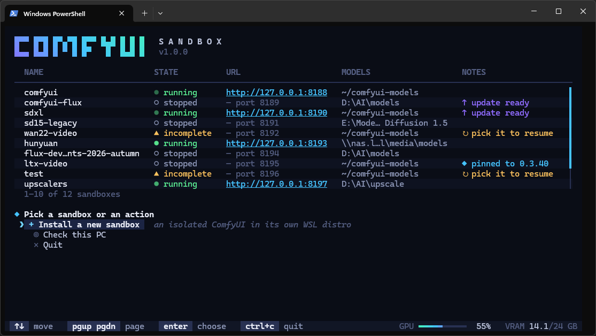

<p align="center">
  
</p>

<p align="center">
  <a href="LICENSE"></a>
  
  
  
  
</p>

<p align="center">
  <b>Run ComfyUI and every custom node you install in a box, not on your Windows machine.</b><br>
</p>


## Why

ComfyUI is great, and its ecosystem of custom nodes is most of the fun. But a custom node is
arbitrary Python code from the internet, and it runs with your rights: it can read your documents,
your browser profile and your SSH keys, and start any program you can.

This has already happened. A malicious node stole passwords, credit cards and crypto wallets
([Hackread](https://hackread.com/comfyui-malicious-node-steal-crypto-browser-data/),
[404 Media](https://www.404media.co/man-who-hacked-disney-with-malicious-ai-tool-pleads-guilty)),
a hijacked dependency of popular nodes installed a crypto miner
([BleepingComputer](https://www.bleepingcomputer.com/news/security/ultralytics-ai-model-hijacked-to-infect-thousands-with-cryptominer/)),
and attackers turned over 1,000 exposed ComfyUI servers into miners
([The Hacker News](https://thehackernews.com/2026/04/over-1000-exposed-comfyui-instances.html)).

**comfyui-sandbox** puts a wall between that code and Windows, without making you learn WSL,
Docker or the NVIDIA Container Toolkit.

- 🧱 **Isolated by default.** Hardened Ubuntu 26.04 WSL2 distro, non-root container with every Linux capability dropped.
- 🔒 **Local only.** The port is published on `127.0.0.1`, never on your network.
- ⚡ **Full GPU speed.** NVIDIA GPUs with the right CUDA build
  picked for your card. CPU-only works too, slowly.
- 📦 **As many as you need.** Pin each sandbox to its own ComfyUI/Python version and nodes, so old workflows keep working.
- 🖥️ **Two front ends, one core.** A full-screen terminal UI for people, and a CLI for scripts and AI agents.
- ♻️ **Safe to retry.** Installs resume where they stopped. Destructive actions ask for your attention.
- 🧰 **The whole lifecycle.** Install, start, stop, update, install nodes, back up, restore,
  reinstall and uninstall.

<br/>

<p align="center">
  
  <br><sub><code>comfyui-sandbox</code> opens home, with every sandbox on this PC</sub>
</p>

## Get Started

**You need:**

- Windows with hardware virtualization on (Linux support is on the roadmap),
- WSL 2.4.4 or newer, with kernel 6.6 or newer (`comfyui-sandbox` installs or updates it for you),
- an NVIDIA GPU with a current Windows driver
 (AMD and Intel GPUs are not supported yet),
- about 30 GB free for ComfyUI and PyTorch, plus room for your models.

**1. Install [uv](https://docs.astral.sh/uv/)**, in PowerShell:

```powershell
winget install astral-sh.uv
```

Then open a new terminal window, so `uv` is on your PATH.

**2. Install `comfyui-sandbox`**:

```powershell
uv tool install git+https://github.com/7ahery/comfyui-sandbox@v1.0.0
```

**3. Run ComfyUI Sandbox,** in PowerShell:

```powershell
comfyui-sandbox
```


Pick **Install a new sandbox**, answer the questions, and
watch it build. The first install takes a while.


> [!NOTE]
> ComfyUI runs while its **run window** is open. Close the window and ComfyUI stops, so nothing
> keeps running in the background without you knowing.

## How the isolation works

Every sandbox is built from the same layers, and `comfyui-sandbox verify` checks each one on the
running system:

| Layer | What it does |
|---|---|
| **Its own WSL2 distro** | A fresh Ubuntu 26.04 used for nothing else, created for this sandbox. Your other distros are left alone (WSL's memory limits are shared, and raised only if you choose to). |
| **No Windows drives** | `automount` is off: no `C:`, `D:`… inside Linux. The only Windows folder ever mounted is a models folder you chose, and it is mounted `noexec,nosuid,nodev`. |
| **No Windows programs** | `interop` is off and the Windows `PATH` isn't added, so nothing in the distro can launch `cmd.exe`, `powershell.exe` or any other Windows program. |
| **Docker Engine, not Docker Desktop** | Installed inside the distro. Nothing on the Windows side, and no `docker.sock` handed to the container. |
| **A non-root container** | ComfyUI runs as an unprivileged user, with every Linux capability dropped and `no-new-privileges` set (also as the Docker daemon's default). Not privileged, no host networking. |
| **Only two mounts** | The container sees its own `data/` folder and the models folder. That's it. |
| **Localhost only** | The port is bound to `127.0.0.1` on Windows. Nothing else on your network can reach it. |
| **Never starts by itself** | No restart policy. Booting the distro or Docker leaves ComfyUI off until you start it. |

## Everyday use

Most people live in **home** (`comfyui-sandbox` with no arguments). Everything home does, the CLI does too:

| You want to | Run |
|---|---|
| Start ComfyUI in its run window | `comfyui-sandbox start` |
| Open a running ComfyUI in the browser | `comfyui-sandbox open` |
| Stop it | `comfyui-sandbox stop` |
| See whether it's running and healthy | `comfyui-sandbox status` · `comfyui-sandbox verify` |
| Read ComfyUI's log | `comfyui-sandbox logs --tail 200` (or `--follow`) |
| Install a custom node | `comfyui-sandbox node install <registry-id or git URL>` |
| See what has updates | `comfyui-sandbox update` |
| Update everything | `comfyui-sandbox update all` |
| Switch to nightly, or pin a release | `comfyui-sandbox update comfyui --version nightly` · `--version 0.3.40` |
| Change the port, launch flags, models folder, Manager UI or security level | `comfyui-sandbox config --port 8189` · `--launch-flags "--lowvram"` · … |
| Back up workflows, inputs and outputs | `comfyui-sandbox backup` |
| Restore a backup | `comfyui-sandbox restore` |
| Give WSL more memory, CPUs or swap | `comfyui-sandbox wslconfig show` · `wslconfig apply --limits suggested` |
| Run comfy-cli or the Manager CLI inside | `comfyui-sandbox comfy <args>` · `comfyui-sandbox cm-cli <args>` |
| Run any command in the distro | `comfyui-sandbox exec -- <command>` |
| Rebuild the image, keeping your data | `comfyui-sandbox rebuild` |
| Start over with a fresh ComfyUI (keeps models and backups) | `comfyui-sandbox reinstall` |
| Recreate the desktop and Start menu shortcuts | `comfyui-sandbox launcher install` |
| Remove everything | `comfyui-sandbox uninstall` |

With more than one sandbox, add `--distro <name>` to pick one. `comfyui-sandbox <command> --help`
lists every option.

### Where your models live

You pick one at install time, and `config --models-path` can change it later.

- **A Windows folder**, such as `C:\AI\models`: share one models folder with Forge, A1111 and other
  tools. Initial model loading is slower through the WSL file bridge.
- **Inside WSL**: `~/comfyui-models` in the distro. Loads fastest and needs nothing on
  Windows. Copy files in through Explorer at `\\wsl.localhost\<sandbox>\home\<user>\comfyui-models`.


## Scripting and automation

Every question the installer asks has a flag, so the whole flow runs unattended:

```powershell
comfyui-sandbox install --non-interactive --distro comfy-docker --user comfy `
    --models wsl --memory tune --manager-ui legacy --security normal
```

- `--json` prints exactly one JSON document on stdout (`command`, `ok`, `exit_code`, `message`,
  `data`, and `log`, `error` or `flag` when they apply). Progress goes to stderr.
- `--non-interactive` never prompts. A missing answer exits with code 9, and `flag` names the flag
  to add.
- `--yes` accepts the defaults, but never confirms anything destructive. Deleting or overwriting
  needs `--confirm <sandbox-name>`.
- Every command that changes something writes a transcript to `%USERPROFILE%\.comfyui-sandbox\logs\`.
  `comfyui-sandbox logs --cli --last` prints the newest one.

<details>
<summary><b>Exit codes</b></summary>

| Code | Meaning |
|---|---|
| 0 | Success. |
| 1 | Failed. `error` says why, and `log` points to the transcript. |
| 2 | Usage error: a bad flag or value. |
| 3 | No NVIDIA GPU. CPU-only is possible. |
| 4 | Not Windows. |
| 5 | Virtualization is off in the BIOS/UEFI. |
| 6 | NVIDIA GPU without a working driver. |
| 7 | WSL is missing or too old, or Virtual Machine Platform is off. Run `prereqs`. |
| 8 | Destructive action refused: `--confirm <sandbox>` was missing or didn't match. |
| 9 | An answer is missing under `--non-interactive`. `flag` names it. |
| 10 | Not ready yet. Safe to retry. |
| 130 | Interrupted. |

`comfy`, `cm-cli` and `exec` exit with the inner command's own code. The full interface, including
each command's `data`, is in [docs/contracts.md](docs/contracts.md).

</details>


## Troubleshooting

1. `comfyui-sandbox check`: is the PC still ready (driver, WSL, virtualization)?
2. `comfyui-sandbox status` and `comfyui-sandbox verify`: is the sandbox healthy and locked down?
3. `comfyui-sandbox logs --tail 200`: what did ComfyUI say?
4. `comfyui-sandbox logs --cli --last`: what did the last command do, step by step?

Still stuck? [Open an issue](../../issues) with the output of `check` and
`logs --cli --last`. Look through them for anything personal first.

## Development

[CONTRIBUTING.md](CONTRIBUTING.md)
covers the setup, the snapshot tests for the terminal UI and the lint and import rules. If you want to
know why something is the way it is, [docs/adr/](docs/adr/) and [docs/scripting.md](docs/scripting.md) explain it.

## Security

Found a way out of the sandbox? Please report it privately, as described in
[SECURITY.md](SECURITY.md), rather than in a public issue.

## Acknowledgements

comfyui-sandbox only puts other people's excellent work in a box:
[ComfyUI](https://github.com/comfyanonymous/ComfyUI),
[ComfyUI-Manager](https://github.com/Comfy-Org/ComfyUI-Manager),
[comfy-cli](https://github.com/Comfy-Org/comfy-cli),
[Docker](https://www.docker.com/),
the [NVIDIA Container Toolkit](https://github.com/NVIDIA/nvidia-container-toolkit),
[WSL](https://github.com/microsoft/WSL), and, for the tool itself,
[uv](https://github.com/astral-sh/uv), [Typer](https://typer.tiangolo.com/),
[Rich](https://github.com/Textualize/rich) and [Textual](https://textual.textualize.io/).

## License

[MIT](LICENSE). comfyui-sandbox is an independent project, not affiliated with ComfyUI, Comfy Org,
Microsoft or NVIDIA.
